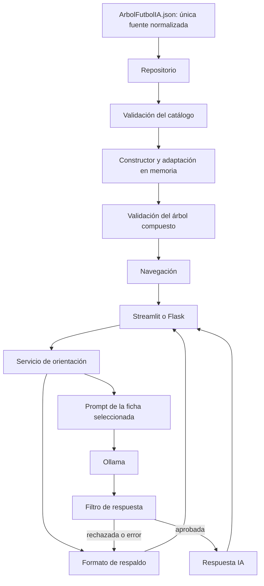

# Arquitectura SOLID de FutbolIA

## Separación de responsabilidades

El catálogo y sus políticas viven exclusivamente en `datos/ArbolFutbolIA.json`, en formato normalizado `catalogo_futbolia` versión 1. El archivo guarda temas, áreas, niveles y contextos una sola vez. No persiste las 192 combinaciones. `catalogo.json` se retiró; el nombre Python `CATALOGO_JSON` permanece como alias de la misma ruta para compatibilidad.

El repositorio reconoce la fuente normalizada, la compone en memoria y valida el árbol resultante antes de entregarlo a las interfaces. Conserva lectura del formato expandido antiguo. La migración mantiene exactamente los 453 nodos y las 192 orientaciones originales, verificados mediante una huella del árbol completo. El almacenamiento crece por definiciones; la expansión en memoria conserva temporalmente el contrato de navegación existente.

## SOLID aplicado

### Responsabilidad única (SRP)

La persistencia cambia si cambia la codificación o la forma de guardar archivos. La validación cambia si cambia el contrato de datos. La adaptación cambia si cambia la forma de aplicar políticas. La navegación cambia si cambia el recorrido. El transporte cambia si cambia la API de Ollama. Las interfaces cambian si cambia la presentación. Ninguno de esos motivos obliga a modificar los otros componentes.

`generar_arbol.py` valida y construye en memoria sin escribir el producto cartesiano en disco. `crear_modelfile.py` compone el resumen del modelo a partir del mismo repositorio validado. `arbol.py`, `guia.py` y `ApiLocal.py` son fachadas de compatibilidad, no nuevas implementaciones paralelas.

### Abierto/cerrado (OCP)

Los contenidos, las áreas, los niveles, los contextos y las políticas de adaptación se amplían desde JSON. El constructor no contiene ramas por identificador de nivel o contexto. Existe una prueba que añade un cuarto nivel con sus políticas sin modificar Python. Un cambio al lenguaje de políticas sí requiere evolucionar su contrato y su intérprete.

Los filtros y las fuentes de orientación son dependencias del servicio: se pueden sustituir sin editar la coordinación de respaldo.

### Sustitución de Liskov (LSP)

No hay una jerarquía de herencia que necesite clases artificiales. Los clientes sustituibles respetan el contrato `(prompt, modelo, temperatura) -> texto`; los validadores devuelven `(aceptada, motivos)`. Las pruebas comprueban resultados con clientes sustitutos, con respuestas rechazadas y con transporte fallido.

### Segregación de interfaces (ISP)

El servicio recibe funciones pequeñas para consultar, validar, formatear y construir el prompt. No necesita un objeto que exponga red, archivos, navegación y UI. La fábrica Flask permite inyectar únicamente árbol y generador de orientación.

### Inversión de dependencias (DIP)

`ServicioGuia` depende del contrato de funciones, no de Flask ni Streamlit. `ApiLocal.py` compone por defecto el adaptador Ollama; `create_app(arbol, generador)` compone la web. Las pruebas sustituyen esas fronteras sin servidor de IA. Las reglas de dominio se comprueban con datos reales en memoria.

## Integridad JSON

La decodificación rechaza claves duplicadas, NaN, Infinity y exponentes que desbordan. El catálogo comprueba tipos, textos, listas y referencias de área. El árbol comprueba niveles y transiciones, ramas truncadas, duplicados entre hermanos, identificadores de hojas únicos y correspondencia de la ficha con el área, tema, nivel y contexto de su ruta.

Los identificadores de hojas son globales; los de opciones como `principiante` se reutilizan en ramas distintas y solo deben ser únicos entre hermanos.

La utilidad general de escritura JSON serializa antes de tocar el destino y usa reemplazo atómico. El comando de validación del árbol no utiliza esa escritura: nunca vuelve a expandir el archivo normalizado. La migración comprobó la fuente guardada antes de retirar el archivo duplicado.

## Interfaces

Flask distingue lectura del cuerpo JSON, validación de opciones, navegación, presentación y orientación. Devuelve errores JSON 400 para solicitudes inválidas y 413 para cuerpos excesivos. HTML, estilos y comportamiento están en archivos independientes. La navegación del navegador mantiene una revisión para descartar respuestas tardías pertenecientes a otra ruta.

Streamlit recibe copias del árbol desde una caché asociada a la revisión del archivo. Las guías se identifican por ruta, modelo, temperatura, uso de IA y revisión del árbol. Un cambio de configuración no muestra la guía de otra configuración. Las rutas obsoletas se reinician y las opciones inválidas muestran un error sin interrumpir la interfaz.

## Modelo y respaldo

El Modelfile se genera desde el árbol validado. Mantiene reglas permanentes y una síntesis de concepto/objetivo por tema. No duplica todas las variantes dentro del contexto permanente; el prompt adjunta la ficha completa de la consulta.

El cliente Ollama tiene espera acotada de 60 segundos. El servicio devuelve respaldo si la IA está desactivada, falla el transporte o la respuesta no supera los filtros. La configuración se valida antes de consultar para no ocultar errores de entrada como si fueran caídas del modelo.

El filtro es preventivo y heurístico, no garantiza comprensión semántica completa. Comprueba patrones inseguros, pertinencia básica y cifras de carga o duración no presentes en la ficha. La revisión humana del contenido sigue siendo necesaria para su uso real.

## Verificación reproducible

Ejecutar `.venv\Scripts\python.exe scripts/verificar.py` desde la raíz. Revisa dependencias, compila el código Python y ejecuta las pruebas. Con dependencias de desarrollo, ejecutar también `ruff check .` y `ruff format --check .`.

El diagrama SVG complementario se regenera con `python docs/crear_diagrama.py`.
